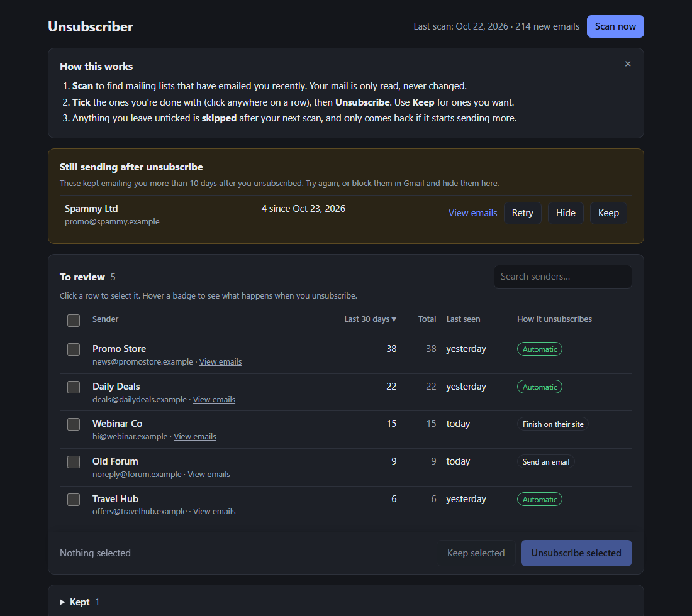

# Gmail Unsubscriber

[](https://github.com/saigorupati/gmail-unsubscriber/actions/workflows/tests.yml)
[](LICENSE)


A small app that runs on your own computer. Once a month, it scans your Gmail, shows which
mailing lists send you the most mail, and unsubscribes you from the ones you tick.



## Features

- **Ranked by recent volume.** The mailing lists that sent the most in the last 30 days are at the top.
- **Bulk unsubscribe.** Most senders support one-click unsubscribe ([RFC 8058](https://www.rfc-editor.org/rfc/rfc8058)),
  so the app handles them instantly. For the rest, it opens the sender's page or a pre-filled Gmail draft.
- **Catches senders who ignore you.** A "Still sending" section flags lists that keep emailing
  more than 10 days after you unsubscribed.
- **Fast monthly check-ins.** After the first scan, it only reads new mail.

## Privacy

- **Read-only.** The app only asks Google for permission to *read* your mail. It can't delete,
  move, label, or send anything.
- **Stays on your computer.** It stores sender addresses, dates, and unsubscribe headers in a
  local file (`unsubscriber.db`). It never downloads email bodies or subjects. The only requests
  it sends anywhere besides Google are the unsubscribe requests for senders you picked.
- **Remembers your choices.** Senders you keep, unsubscribe from, or skip don't come back
  next month. A skipped list returns only if it starts sending more than before.

## Install (once)

Requires Python 3.13 or newer.

```powershell
py -3.13 -m venv .venv
.venv\Scripts\python -m pip install -r requirements.txt
```

## Google setup (once, about 10 minutes)

1. In [Google Cloud Console](https://console.cloud.google.com/projectcreate), create a project.
2. Enable the [Gmail API](https://console.cloud.google.com/apis/library/gmail.googleapis.com).
3. Open [Google Auth Platform](https://console.cloud.google.com/auth/overview) (the OAuth consent
   screen). Choose **External**, enter an app name and your email, and leave it in **Testing**.
4. Under **Audience → Test users**, add your own Gmail address.
5. Under **Clients**, create a client of type **Desktop app** and download its JSON.
6. Save the file as `credentials.json` in this folder.

## Monthly use

```powershell
.\run.ps1
```

Your browser opens the app.

1. Click **Scan now**. The first scan reads the past 30 days of mail (change `FIRST_SCAN_DAYS`
   in `unsubscriber/config.py` to go further back). If it stops partway, click Scan again and it
   picks up where it left off. Later scans only read mail that arrived since the last scan.
2. Tick the senders you're done with, then click **Unsubscribe selected**.
   - **One-click** senders are handled immediately.
   - Others show up under **Finish these**. Click each one to open the sender's unsubscribe page
     or a pre-filled Gmail draft (you click Send).
3. Use **Keep selected** for lists you want. Anything you leave unticked is skipped at the next
   scan.
4. **Still sending after unsubscribe** lists senders who kept emailing more than 10 days after
   you unsubscribed. Use **Retry**, block them in Gmail and click **Hide**, or **Keep** them.

Press `Ctrl+C` in the terminal to stop the app.

## Signing in again

While your Google project is in **Testing** mode, Google expires your sign-in after 7 days. Since
you use this monthly, you'll usually click **Sign in with Google** again. That's expected.

To avoid it, you can switch the project to **In production** under Google Auth Platform →
Audience without submitting it for verification. Google will then show an "app isn't verified"
warning when you sign in (click *Advanced → Go to app*), but your sign-in will stop expiring
weekly.

## Tests

```powershell
.venv\Scripts\python -m pytest
```

## How it works

| Part | File |
|---|---|
| Reads email headers (sender, `List-Unsubscribe`) | `unsubscriber/headers.py` |
| Local SQLite storage | `unsubscriber/db.py` |
| What shows up for review, skipping, "still sending" | `unsubscriber/review.py` |
| Gmail API access (read-only, batched, rate-limited) | `unsubscriber/gmail_client.py` |
| Full and incremental scans | `unsubscriber/scanner.py` |
| One-click POST and manual unsubscribe links | `unsubscriber/unsubscribe.py` |
| Local web page and API (`127.0.0.1` only) | `unsubscriber/web.py` |

The design doc is in [`docs/superpowers/specs`](docs/superpowers/specs).

## License

[MIT](LICENSE)
